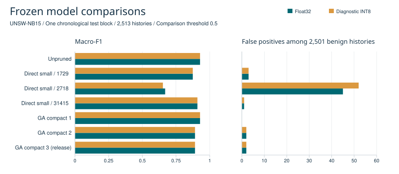

# Model card and locked evaluation

**Release decision.** `cnn-unsw-ga-v1` is an OBSERVE-mode demonstration. On the chronological UNSW-NB15 test block it detected 9 of 12 attack-labeled histories and flagged 2 of 2,501 benign histories. Both the compact and unpruned models missed three attack histories. The two additional false positives reduced compact macro-F1 from the unpruned model’s 0.9283 to 0.8908. The **0.0375 loss exceeded the registered 0.02 limit**. The deployment threshold remains unset.

## Model and intended use

The model scores whether a device’s **final one-second window** contains traffic associated with an in-scope attack. Its input is eight consecutive, quality-valid IPv4 windows in chronological order, each containing 16 counts and timing or length statistics. The worker applies the frozen training transform once, runs two temporal convolution layers with 25 and 15 channels, pools over time, and applies a sigmoid to the binary logit. The 2,381-parameter float32 program occupies 15,236 bytes. The score is uncalibrated. Its intended use is inspecting observed traffic and testing gateway integration. [Feature definitions](contracts/v1/feature_schema.json) · [Bundle manifest](models/cnn-unsw-ga-v1/manifest.json)

The unpruned parent used 64 and 32 channels. Training used 6,457 histories, including 19 reconnaissance and 5 denial-of-service histories. Training alone supplied the preprocessing statistics. Development had 964 benign histories, one reconnaissance history and zero denial-of-service histories. Architecture, weights, transform, program hashes, dataset hashes and the inclusive comparison threshold of 0.5 were registered before test inference. The reserve for choosing an operating threshold was unused. All seven checkpoints ran in float32 and diagnostic INT8. Representative idle histories were missing from INT8 calibration. [Pre-score freeze commit](https://github.com/aayushh-jadhavv/ai-soc-iot/commit/73013b4ce68af20e9f146736032247430a1e6812) · [Training evidence](https://github.com/aayushh-jadhavv/ai-soc-iot/blob/ebc89bd71523bef874e486ca2afa2a89070e71dd/experiments/phase3/run-002/REPORT.md)

## Locked score-level results

The test interval is the last chronological block of two adjoining UNSW-NB15 captures from 22 January 2015. Training, validation and test share **one original capture group**. The audit found zero shared physical windows and zero shared connections across those partitions. Overlapping histories, endpoint views and the single source group preclude an independent-group confidence interval. [Dataset audit](evaluation/dataset-audit.json)

Of 11,016 observed endpoint-seconds in the test block, 5,301 had an in-scope final label (48.12%). Complete eligible histories covered 2,513 endpoint-seconds (22.81%). Primary exclusions were 3,591 during history warm-up, 3,513 with invalid capture coverage, 646 with an unknown final label, 451 outside the target families and 302 touched by a connection crossing a split. Attack prevalence among scored histories was 12/2,513 (0.48%).

| Float32 model | TP | FP | FN | TN | Precision | Recall | Macro-F1 | PR-AUC¹ |
| --- | ---: | ---: | ---: | ---: | ---: | ---: | ---: | ---: |
| Unpruned | 9 | 0 | 3 | 2,501 | 1.0000 | 0.7500 | 0.9283 | 0.7734 |
| Direct small, seed 1729 | 9 | 3 | 3 | 2,498 | 0.7500 | 0.7500 | 0.8744 | 0.8112 |
| Direct small, seed 2718 | 12 | 45 | 0 | 2,456 | 0.2105 | 1.0000 | 0.6694 | 0.9693 |
| Direct small, seed 31415 | 9 | 1 | 3 | 2,500 | 0.9000 | 0.7500 | 0.9087 | 0.8199 |
| GA compact 1 | 9 | 0 | 3 | 2,501 | 1.0000 | 0.7500 | 0.9283 | 0.7520 |
| GA compact 2 | 9 | 2 | 3 | 2,499 | 0.8182 | 0.7500 | 0.8908 | 0.7520 |
| **GA compact 3, shipped** | **9** | **2** | **3** | **2,499** | **0.8182** | **0.7500** | **0.8908** | **0.7518** |

¹ Non-interpolated average precision with tied scores grouped. All rows use the frozen comparison threshold for confusion counts. The release model flagged **9/11 reconnaissance**, **0/1 denial-of-service** and **2/2,501 benign** histories. These are binary decisions on labeled traffic. Per-family and per-group results for every float32 and INT8 program can be recomputed from the ledger. [Locked results](evaluation/results.json) · [Per-history scores](evaluation/scores.csv.gz)

## Gateway and worker measurements

Three recorded Raspberry Pi 3 Model B Plus Rev 1.3 trials on 64-bit Linux exercised a Windows client sending IPv4 ICMP through the gateway capture interface. All 60 probes received replies. Each trial produced eight consecutive windows with one outgoing echo request per window, a correlated inference response, zero callback overflows and zero tcpdump kernel drops. Single forward calls took 0.459–0.464 ms. The earlier board fixture replay passed at 0.01076234. The worker had a deadline error in its history before those trials. These measurements apply to the recorded board build and this workload.

For this release, an offline run of the updated gateway on Ubuntu replayed the three ICMP-filtered captures through the real worker. All 24 outgoing ICMP counts and window start times matched the board records. Replaying the three saved full live requests reproduced their recorded scores. The captured ICMP subset and full live traffic have different coverage. [Pi measurements, capture digests and replay results](evaluation/pi-trials.json)

In a separate x86-64 Ubuntu WSL2 run, 20 staggered clients each sent one fixture request per second for 15 rounds. All 300 requests returned a correlated score. Median round-trip latency was 7.54 ms and p95 was 11.36 ms. Median forward time was 0.50 ms and p95 was 1.01 ms. Cold start to readiness took 11.68 seconds. The worker consumed 2.11 CPU-seconds and its sampled peak resident memory was 353 MiB. These measurements cover the loopback worker. Capture performance on a busy network remains unmeasured. [Load profile and environment](evaluation/worker-profile.json)

## Evidence still needed for deployment

| Question | Available evidence |
| --- | --- |
| Does detection generalize to independent UNSW sessions or devices? | No independently held-out group was available. A separately recorded and labeled session is needed. |
| How does it perform on CSE-CIC-IDS2018 or BoT-IoT? | Neither dataset supplied a validated raw-capture and annotation pair to this release. Each needs its own evaluation. |
| How often would the gateway raise false incidents, and how quickly would it alert? | OBSERVE mode emits scores. Measuring false incidents per benign device-hour and onset-to-alert delay requires an incident policy, an event log and ground-truth time intervals. |
| Which threats and traffic are in scope? | The two audited positive families are reconnaissance and denial of service. IPv6, other families, phishing and zero-day detection are untested. |

The published test outcomes are now known. Any model, calibration or threshold revision informed by them needs a fresh final test set.
